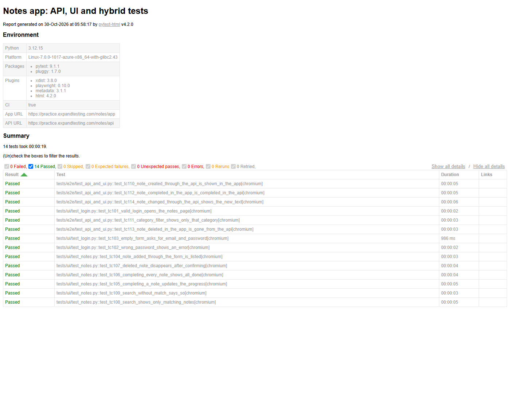
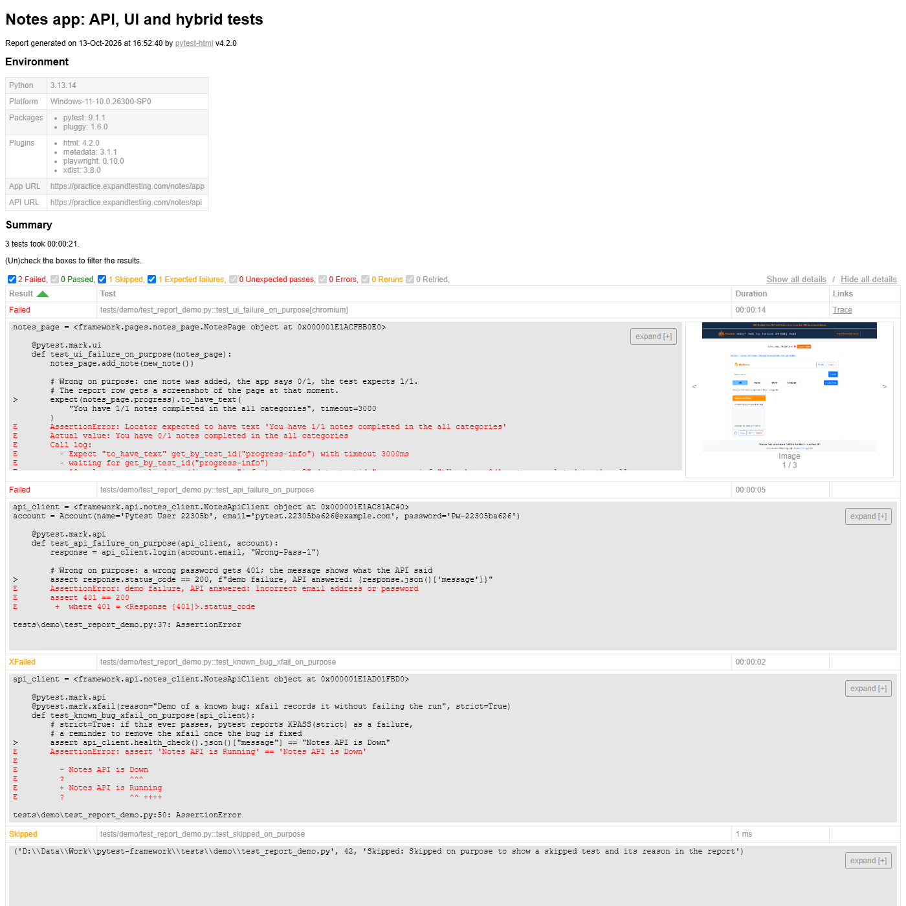

# Python pytest Framework

[](https://github.com/niranjankagri/python-pytest-framework/actions/workflows/ci.yml)

A test automation framework in **Python** using **pytest**, **Playwright for Python**, **requests** and
**pydantic**. It tests the public [Expand Testing Notes app](https://practice.expandtesting.com/notes/app).
The app has a web UI and a REST API on the same backend. The framework tests each side on its own,
and also both together: hybrid tests set up data through the API and check it in the browser.

| | |
|---|---|
| Tests | 46: 32 API, 9 UI and 5 hybrid. Also 4 report demo tests that fail, skip and xfail on purpose |
| Browsers | Chromium, Firefox, WebKit (Safari's engine) |
| Speed | about 1 m 45 s for the 46 tests with 4 parallel workers (pytest-xdist) |
| Reports | one self-contained HTML file; a failed UI test gets an embedded screenshot, plus a trace and video in `test-results/` |
| CI | GitHub Actions: lint first, then API tests, then UI + hybrid tests on all three browsers in parallel; also runs nightly |

## Tech stack

| Tool | Version | Used for |
|---|---|---|
| Python | 3.11+ (CI: 3.12) | language |
| pytest | 9.1.1 | runner, fixtures, markers, parametrize |
| pytest-xdist | 3.8.0 | parallel runs (`-n 4`) |
| pytest-html | 4.2.0 | HTML report |
| Playwright + pytest-playwright | 1.64.1 / 0.10.0 | browser tests, `--browser`, screenshots, video, traces |
| requests | 2.34.2 | REST API client |
| pydantic | 2.14.1 | response contracts (schema checks) |
| ruff | 0.17.2 | lint and format |

## Project structure

```
python-pytest-framework
├── framework/                    reusable code, no tests and no assertions
│   ├── config.py                 Settings: URLs and timeouts from environment variables
│   ├── api/
│   │   ├── notes_client.py       NotesApiClient: one method per API endpoint (requests.Session)
│   │   └── models.py             pydantic models: the API's contract (User, Note, ApiResponse[T])
│   ├── pages/
│   │   ├── login_page.py         LoginPage: Page Object of the login form
│   │   └── notes_page.py         NotesPage: Page Object of the notes list, form, search, filters
│   └── data/
│       └── factories.py          unique users and notes for every test
├── tests/
│   ├── conftest.py               fixtures: settings, API clients, throwaway accounts, pages, report hooks
│   ├── api/                      REST API tests (no browser)
│   ├── ui/                       browser tests
│   ├── e2e/                      hybrid tests: API + UI in one test
│   └── demo/                     report demo: fail, skip, xfail on purpose (only with -m demo)
├── .github/
│   ├── workflows/ci.yml          CI pipeline
│   └── scripts/summary.py        pass/fail table for the GitHub run summary
├── docs/
│   ├── framework-design.md       why the framework is built this way
│   └── images/                   report screenshots
├── pytest.ini                    markers, default options, report settings
├── pyproject.toml                ruff settings
└── requirements.txt              pinned dependencies
```

## Layers

Tests use only the framework layer, which hides the HTTP and HTML details.

```
tests (what is checked)          tests/api, tests/ui, tests/e2e
        │  uses fixtures from
fixtures (set-up / clean-up)     tests/conftest.py
        │  uses
framework (how to talk to it)    api/NotesApiClient + models   pages/LoginPage, NotesPage   data/factories
        │  reads
config (where it is)             framework/config.py  ←  environment variables
```

- **config** holds one frozen `Settings` object with the app URL, the API URL and the timeouts.
- **api** has `NotesApiClient`, which sends the requests and keeps the login token. Each method
  returns the raw `requests.Response`, so a test can check any status code, including errors.
  `models.py` turns a response body into typed objects. It fails on a missing field and on any
  field it does not expect (`extra="forbid"`).
- **pages** holds the Page Objects: locators (`data-testid` attributes) and user actions. They make
  no assertions. Tests assert with Playwright's `expect`, which waits and retries.
- **data** returns new, unique data (`uuid`) on every call, so parallel tests never collide.
- **fixtures** create what a test needs and remove it afterwards (see the flow below).

## How a test runs

**API test**, for example `test_get_note_by_id(logged_in_client)`:

1. The `settings` fixture reads the environment, once per run.
2. The `account` fixture registers a brand-new user through the API.
3. The `logged_in_client` fixture logs that user in. The client stores the token and sends it as
   `x-auth-token` on every later call.
4. The test calls the client. It checks the status code, then checks the body through a pydantic
   model: `ApiResponse[Note].model_validate(response.json())`.
5. Teardown deletes the account and, with it, all its notes. This also runs when the test failed.

**UI test**, for example `test_completing_a_note_updates_the_progress(notes_page)`:

1. A user is registered and logged in through the API (steps 1-3 above). This is much faster than
   filling in the login form every time.
2. pytest-playwright starts the browser chosen with `--browser`. Each test gets a new context, with
   fresh cookies and storage; `browser_context_args` sets the viewport.
3. `app_page` blocks the ad and tracking hosts of the public demo site. Pages load faster, and no ad
   covers a button.
4. `notes_page` puts the API token into the app's `localStorage` before the first page load, then
   opens the notes page. The browser is logged in without using the login form; the form itself
   is tested in `tests/ui/test_login.py`.
5. The test uses `NotesPage` actions and checks the page with `expect(...)`.
6. On failure, the report row gets a full-page screenshot. Playwright also keeps a screenshot, a video
   and a trace in `test-results/`.
7. Teardown deletes the account.

**Hybrid test**, for example `test_note_completed_in_the_app_is_completed_in_the_api`:

1. It creates notes through the API.
2. It changes them in the browser.
3. It checks the result through the API again.

Each side checks the other, and the set-up costs one HTTP call instead of a form.

## What is tested

| File | Tests |
|---|---|
| `api/test_health.py` | the API is up |
| `api/test_users.py` | register, including a duplicate email and field validation; login returns a token; the same 401 for a wrong password and an unknown user; profile with a missing or invalid token; profile update and phone validation; password change; logout invalidates the token |
| `api/test_notes.py` | create in every category, list, get by id, PUT, PATCH, delete then 404, field validation, malformed id 400 and unknown id 404; one user cannot see or delete another's notes; a token is required |
| `ui/test_login.py` | valid login, wrong password message, empty form messages |
| `ui/test_notes.py` | add a note, progress counter, "all completed" message, delete with confirmation, search with and without a match |
| `e2e/test_api_and_ui.py` | API → UI: created and changed notes are shown, category filter works. UI → API: notes completed or deleted in the app |
| `demo/test_report_demo.py` | one UI failure, one API failure, one skip and one strict xfail, to show each result in the report |

The markers are defined in `pytest.ini`: `api`, `ui`, `e2e`, `smoke` and `demo`. `smoke` marks the 9
quickest checks of the main paths. `--strict-markers` turns a misspelt marker into an error.

## Setup

```
git clone https://github.com/niranjankagri/python-pytest-framework.git
cd python-pytest-framework
python -m venv .venv
.venv\Scripts\activate          # Windows (macOS/Linux: source .venv/bin/activate)
pip install -r requirements.txt
playwright install chromium firefox webkit
```

## Configuration

The public demo needs no settings. To run against another copy of the app, set these:

| Variable | Default |
|---|---|
| `NOTES_APP_URL` | `https://practice.expandtesting.com/notes/app` |
| `NOTES_API_URL` | `https://practice.expandtesting.com/notes/api` |
| `NOTES_API_TIMEOUT` | `30` (seconds per API request) |
| `NOTES_UI_TIMEOUT_MS` | `15000` (Playwright wait for actions such as click, fill and `wait_for`; `expect` keeps its own 5 s default) |

## Running

```
pytest                                   # all 46 tests, Chromium, headless
pytest -n 4                              # same, 4 parallel workers
pytest -m api                            # API only (no browser needed)
pytest -m "ui or e2e" --browser firefox  # browser tests on Firefox
pytest -m smoke                          # the quickest checks
pytest tests/ui/test_notes.py -k search  # one file, tests whose name contains "search"
pytest -m ui --headed --slowmo 500       # watch the browser
pytest -m demo                           # report demo: 2 failed, 1 skipped, 1 xfailed (on purpose)
```

`--browser` can be given more than once (`--browser chromium --browser webkit`). Every UI test then
runs once per browser.

## Reports

- **`reports/report.html`** is a single file. It shows the environment (versions, app and API URLs),
  the summary, and every test with its duration. Each failure shows the assertion and the log; a UI
  failure also shows a screenshot of the page.
- **`test-results/`** keeps a screenshot, a video and a Playwright trace for each failed UI test.
  Open a trace with `playwright show-trace test-results/<test>/trace.zip`. It lets you step through
  every action and see the DOM, network and console at that moment.
- **`-ra`** prints a short reason for every test that did not pass, at the end of the console output.

A run where all tests passed:



The report demo (`pytest -m demo`) shows:

- the UI failure with its screenshot;
- the API failure with the API's message;
- the strict xfail;
- the skip reason.



## CI (GitHub Actions)

`.github/workflows/ci.yml` runs on every push and pull request, every night and on demand. The
nightly run catches changes to the public site. The jobs are:

1. **lint** runs `ruff check` and `ruff format --check`. The tests only start when the code is clean.
2. **api** runs `pytest -m api -n 4`.
3. **ui** is a matrix of three jobs: Chromium, Firefox and WebKit. Each one installs only its own
   browser, then runs `pytest -m "ui or e2e" --browser <name> -n 3`. With `fail-fast: false`, a
   failure on one browser does not cancel the others.

Each test job writes a pass/fail table to the run's summary page. It also keeps its HTML report and
traces as an artifact. A manual run (Run workflow) can choose the `demo` markers, to see failures in
CI. [Automation Coverage & Quality Intelligence](https://github.com/niranjankagri/automation-coverage-quality-intelligence) reads the
`junit.xml` in these artifacts for its cross-repository dashboard.

Dependabot proposes dependency and GitHub Actions updates once a month (minor and patch updates grouped, major versions as separate pull requests).

`main` is protected by a ruleset: every change goes through a pull request, and the CI jobs above must pass before it is merged.

## Code quality

```
ruff check .          # lint: pyflakes, pycodestyle, isort, bugbear, pyupgrade, pytest style, simplify
ruff format .         # format
```

## More

- [docs/framework-design.md](docs/framework-design.md): the design decisions and their reasons.
- [docs/interview-questions.md](docs/interview-questions.md) ([PDF](docs/interview-questions.pdf)):
  86 pytest, Playwright, API testing and Python interview questions, each linked to the code here.

## License

[MIT](LICENSE)
